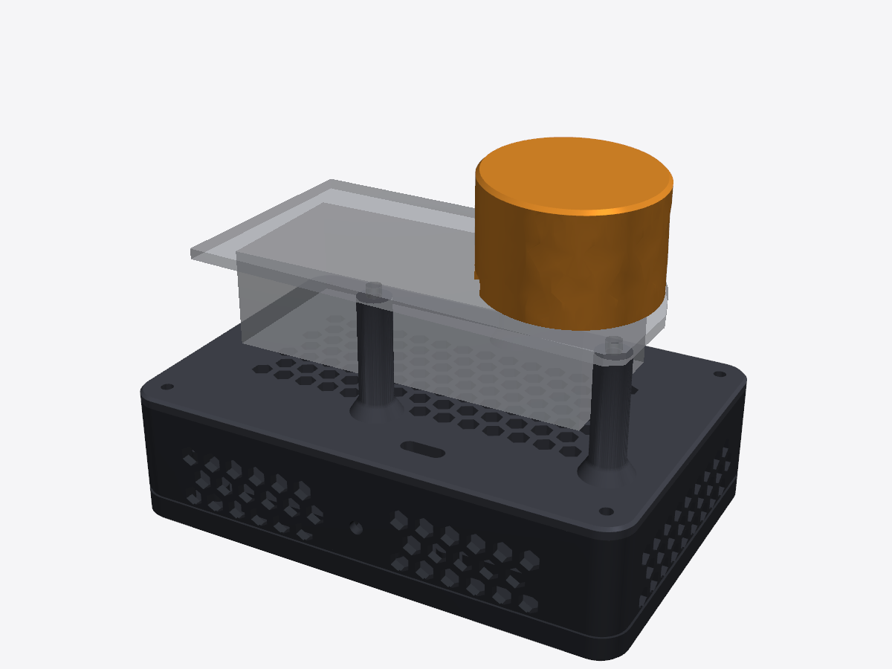

# CyberLamp

A cyberpunk ambient lamp built from a salvaged **Hella DRL / turn-signal LED module** pulled from a wrecked Mercedes-Benz EQB (X243) headlight. A Seeed XIAO ESP32S3 drives the module's amber and white LED strings independently. You control it from a web page on home Wi-Fi, a push button, or the serial monitor.

Modes: off · steady amber · steady white · amber breathing · failing-streetlight glitch · glitch + white arc flashes.

---

## The LED module

| Item | Value |
|---|---|
| Maker | Hella (logo stamped on heatsink) |
| Heatsink stamp | `AB 222.090-02 R7`, `DC` |
| Board markings | `8930F`, `234 358 -10`, `4823`, `5.6`, `ST` |
| Closest listed part | Hella 222090-51 AB, EQB X243 DRL + turn signal module (board code `8927F … 00234357`); ours is likely the sibling/other-side variant |
| Driver on board | None. The constant-current driver lives in the headlamp control unit. The board is bare LED strings plus a few passives (a `30C` 20 kΩ resistor, likely a brightness-bin code, and a small 3-terminal part) |

### Measured pinout

Pins are numbered **1 = leftmost**, with the board oriented connector-up and LEDs below.

| Pin | Function | Forward voltage |
|---|---|---|
| 1 | Common negative (cathode) for both strings | — |
| 2 | Amber string + (turn signal) | 22.93 V @ 2 mA · 23.86 V @ 30 mA |
| 4 | White string + (DRL) | 15.95 V @ 30 mA |
| 3, 5+ | Not LED strings; suspected bin resistor / temperature sensor | — |

Notes from bench testing on the Jesverty SPS-3010V in CC mode:
- 30 mA is plenty bright for ambient use. The amber string handled a brief 730 mA (~20 W) burst with no damage and no heat concerns.
- The amber string won't light below about 22 V. That's why it looked dead when probing stopped at 20 V.
- The "yellow" chips are phosphor-converted **white** LEDs; the orange chips are phosphor-converted **amber**.

---

## How it works

```
USB-C 5 V ──► XIAO ESP32S3 ──5V/GND pins──► XL6019 boost ──► +30 V rail
                    │                                            │
                    │ D0 (PWM)                                   ├─► PNP switch ─► LM317 (189 mA) ──────────► module pin 2 (amber)
                    │ D1 (PWM)                                   └─► PNP switch ─► LM317 (189 mA) ─► 40 Ω ──► module pin 4 (white)
                    │ D3 ◄── mode button                                                            module pin 1 ─► GND
```

- **Why a 30 V rail:** the amber string needs ~24.5–25 V at 189 mA (its forward voltage rises with current), plus ~3.5 V of headroom for the LM317, its current-set resistor and the PNP switch. Set the rail from your own measurement: **amber Vf at 190 mA + 3.5 V**.
- **Why two separate current sources:** pin 1 is a shared negative, so the strings can't be switched independently on the low side. Each one gets its own LM317 current source and its own high-side PNP switch.
- **Current per string:** 1.25 V ÷ 6.6 Ω ≈ **189 mA** at full PWM. That's the ceiling; the web sliders and effects only go dimmer. 30 mA (about 15%) was already plenty for ambient light on the bench, so full scale is room-light bright.
- **Why the white string has 40 Ω in series:** it needs ~8 V less than the amber string. Without the resistors its LM317 would burn ~2.3 W, which is too hot without a heatsink. Four 10 Ω resistors take ~1.4 W of that, leaving the LM317 at ~0.9 W.
- **Power budget:** one string at full draws ~1.5 A from USB-C, and both at full would draw ~2.8 A. The firmware caps the two strings' combined PWM at 1.25 strings' worth, about **2 A from USB-C** including the ESP32 (see [Power cap](#power-cap)). Use a USB-C charger rated **5 V / 3 A**.

## Wiring



Open [`docs/wiring.html`](docs/wiring.html) in a browser for the full sheet: both diagrams, the wire list, part-by-part notes and pinouts, in light and dark themes. The SVGs above and below are exported from that page by `python3 docs/export_diagrams.py`; edit the page, then re-run the script.

Layout matches the mounts in the 3D printed base: driver perfboard front-left, XL6019 front-right, XIAO in its cradle at the back wall.

| From | To | Wire | Notes |
|---|---|---|---|
| XIAO 5V | XL6019 IN+ | 24 AWG, soldered to the header pin | Carries up to ~2 A, too much for a Dupont jumper |
| XIAO GND | XL6019 IN− | 24 AWG, soldered to the header pin | The XIAO's only GND pin. Everything else gets ground through the boost module |
| XL6019 OUT+ | Perfboard J1 +30 V | 24 AWG | Feeds the +30 V bus |
| XL6019 OUT− | Perfboard J1 GND | 24 AWG | Feeds the GND bus |
| XIAO D0 / D1 / D3 | Perfboard J2 pins 1 / 2 / 3 | F-F Dupont jumpers | D3 runs across the perfboard to the button pads |
| Button | Perfboard BTN pads (D3, GND) | 24 AWG | No resistor: the firmware uses the internal pull-up |
| J3 pins 1 / 2 / 3 | Module pins 2 / 4 / 1 | 24 AWG, 30 AWG at the module | Up through the lid slot. Leave module pin 3 and pins after 4 unconnected |

- **One ground path.** The XIAO and the perfboard share ground only through the XL6019, whose IN− and OUT− are joined on the module (it's a non-isolated boost). Confirm IN− and OUT− are continuous on your board before wiring.
- **The XIAO's header pins point up,** soldered from the top, with the USB-C end against the back wall. Clip the solder tails underneath flush so the board sits flat in the cradle and the USB-C lines up with the port.
- **The terminal order (+/−) on your XL6019 may differ** from the drawing. Follow its silkscreen.

### Per-channel schematic (build two: amber on D0 → pin 2, white on D1 → pin 4)



| Ref | Part | Connects | Job |
|---|---|---|---|
| R1 | 4.7 kΩ | J2 (D0 or D1) → Q1 base | Limits base current from the XIAO pin (~0.55 mA) |
| R2 | 100 kΩ | Q1 base → GND | Holds Q1 off while the XIAO boots, so the lamp doesn't flash at power-up |
| Q1 | 2N3904 NPN | E → GND, C → R3 | Shifts the 3.3 V signal so it can switch the 30 V side |
| R3 | 4.7 kΩ ∥ 4.7 kΩ (≈2.35 kΩ) | Q1 collector → Q2 base | Drives Q2 with ~12 mA; two resistors share ~0.35 W |
| R4 | 4.7 kΩ | +30 V → Q2 base | Pulls Q2 off when Q1 is off |
| Q2 | 2N5401 PNP | E → +30 V, C → LM317 IN | High-side switch, PWM at 1 kHz |
| U1 | LM317 | IN ← Q2, OUT → R5, ADJ → output | Constant-current source. The load hangs off **ADJ**, not OUT |
| R5 | 3.3 Ω + 3.3 Ω in series | LM317 OUT → ADJ | Sets ~189 mA; ~0.12 W each |
| R6 | 4 × 10 Ω in series | ADJ → J3 pin 2 (**white only**; amber gets a plain wire) | Drops ~7.6 V; ~0.36 W each |
| C1 | 47–100 µF, ≥50 V (one per board) | Across J1 | Steadies the rail during PWM |

TO-92 pinout for both transistors, flat face toward you, legs down: **E – B – C**. LM317 (TO-220), tab away from you, legs down: **ADJ – OUT – IN**. The LM317 tab is connected to OUT, so keep the two tabs from touching. Double-check against the datasheet for the exact parts you pull.

- XIAO pin **HIGH → NPN on → PNP on → LEDs lit**. The logic isn't inverted.
- **Perfboard layout:** run the +30 V and GND buses as bare wires along the two long edges, stand the LM317s at the back edge with tabs facing out, and stand every resistor upright. Use screw terminals for J1 (a 2-pin block) and J3 (a 3-pin block), and a 3-pin female header for J2.
- Every ground is shared: XIAO GND, XL6019 IN−/OUT−, both 2N3904 emitters, both R2s, the button and module pin 1.

---

## Parts list (checked against PartsInventory)

Everything required is already in the office. IDs refer to `awggie/PartsInventory/parts-inventory.csv`.

| Qty | Part | Inventory ID | Location | Notes |
|---|---|---|---|---|
| 1 | Seeed XIAO ESP32S3 | MCU-003 (2 on hand) | Drawer 2 | Headers not soldered yet. Also needs its 2.4 GHz antenna on the U.FL connector |
| 1 | XL6019 boost module | MOD-006 (2 on hand) | Parts bin row 4 | ~5–35 V out; set the rail **before** connecting anything |
| 2 | LM317 (TO-220) | REG-001 (5) / IC-001 (2) | Drawer 2 | No heatsink needed: ~0.9 W on white (with R6), less on amber |
| 2 | 2N5401 PNP | TR-001 | Drawer 2 | 150 V rated. 2N2907A (60 V) also works |
| 2 | 2N3904 NPN | TR-001 | Drawer 2 | 2N2222 / BC547 also fine |
| — | Resistors per channel: 4.7 kΩ ×4, 100 kΩ ×1, 3.3 Ω ×2 | RES-001 | Drawer 3 | 1/2 W metal film. Double these for two channels |
| 4 | 10 Ω resistors (white channel R6) | RES-001 | Drawer 3 | 1/2 W, running at ~0.36 W each |
| 1 | Electrolytic cap, ≥50 V | CAP-003 | Drawer 3 | 47–100 µF if the kit has one at 50 V; otherwise 2–4 × 10 µF/50 V in parallel |
| 1 | Tactile push button | SW-001 | Bottom drawer | Mode cycling |
| 1 | 60 × 40 mm perfboard | PROTO-004 | Parts bin row 3 | Breadboard first on PROTO-002 |
| 1 + 1 | Screw terminals: one 2-pin, one 3-pin | CON-009 / CON-014 | Parts bin row 3 | 2-pin for J1, 3-pin for J3 |
| — | Pin headers (male for the XIAO, female 3-pin for J2) | CON-008 | Parts bin row 3 | |
| 3 | F-F Dupont jumpers | CAB-004 | Top drawer | XIAO D0/D1/D3 → J2 |
| — | 24 AWG wire, heat shrink | WIRE-004, CONS-005 | Wire rack / parts bin | |
| — | 30 AWG wire for the module connector | WIRE-005 | Wire rack | **No mating plug on hand**: solder fine wires to the pins/pads for pins 1, 2, 4 |
| opt. | 0.96" SSD1306 OLED | KIT-001-09 | Crates | Future: status / telemetry display on D4/D5 (I²C) |

---

## Build and bring-up

1. **Measure the strings first.** Put each string on the bench supply in CC mode at 190 mA and note its forward voltage. Set the rail to **amber Vf + 3.5 V**; it should land near 28–30 V.
2. **Set the boost with nothing connected.** Power the XL6019 from the bench supply at 5 V (current limit ~1 A) with nothing on its output. Turn its trim pot until your multimeter reads the rail voltage from step 1. These modules can ship set to 35 V.
3. **Check the grounds.** Confirm XL6019 IN− and OUT− are continuous.
4. **Breadboard one channel.** Wire the amber channel per the schematic and feed it from the boost. Drive R1 with a jumper to 3.3 V instead of the XIAO. Measure about 189 mA with the DMM in series with the LED wire.
5. **Check temperatures after 10 minutes.** The LM317s, R3 pairs and R6 should be warm, not too hot to touch.
6. **Add the second channel**, then the XIAO and the button.
7. **Flash the firmware** (below). Once it works, move everything to the perfboard.

## Firmware

Located in `firmware/CyberLamp/`.

1. Arduino IDE → Boards Manager → install **esp32 by Espressif** (version 3.x).
2. Select board **XIAO_ESP32S3**.
3. Copy `secrets.example.h` to `secrets.h` and enter your 2.4 GHz Wi-Fi name and password. `secrets.h` is git-ignored.
4. Upload, then open the Serial Monitor at 115200 baud. It prints the lamp's address once connected.

### Controls

- **Web:** open `http://cyberlamp.local` from any device on your home Wi-Fi. If `.local` doesn't resolve on your Android phone, use the IP address printed in the serial monitor, or set a DHCP reservation on your router so the address never changes.
- **Button:** each press cycles to the next mode.
- **Serial:** send `0`–`5` (off, amber, white, breathe, glitch, arcing).

If Wi-Fi is down or not configured, the lamp still runs on the button and serial.

### Power cap

Both strings draw from the same 30 V rail, and every milliamp on it costs about 7 mA at the 5 V USB input. Both strings at full PWM would pull ~2.8 A from USB-C, right at its 3 A limit, so `updateLampOutputs()` caps their combined PWM duty at **1.25 strings' worth** (`maxCombinedDutyInStrings`). The cap works on PWM duty, which is proportional to current, not on perceived brightness.

Only arcing mode lights both strings at once. There the white flash keeps full brightness and the amber dims slightly for the length of the flash, which reads as the lamp sagging. Every other mode is unaffected.

### Security note

The control page has no login: anyone on your home network can change the lamp. That's normal for a LAN gadget, but **don't port-forward it to the internet**. For remote access, use a VPN into your home network (e.g. Tailscale) instead.

---

## 3D printed housing

A parametric enclosure and diffuser, plus quick fit-test prints, live in [`cad/`](cad/). See [cad/README.md](cad/README.md) for print settings and assembly.



---

## License

[MIT](LICENSE). Build your own, remix it, and share it.

Working with salvaged automotive LED modules is at your own risk. These LEDs are bright enough to hurt your eyes up close, so always bring them up with a current-limited supply.
