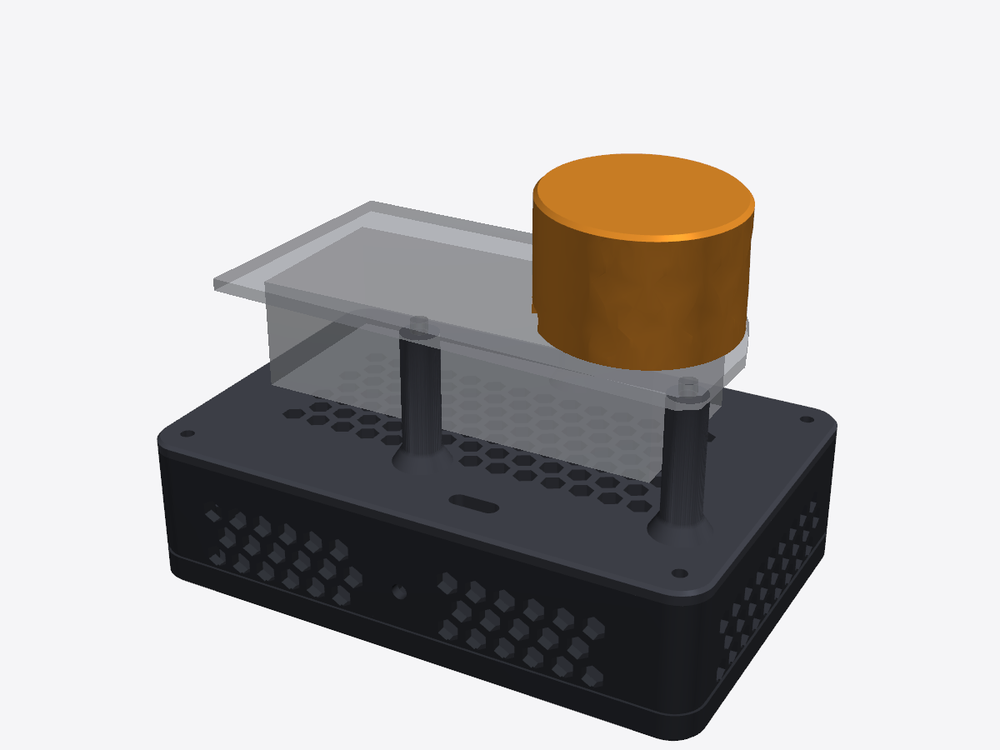

# CyberRunningLamp — 3D printed housing



The LED module lies flat, LEDs up, on three standoffs above an electronics base. Both of its fin sets stay exposed. A frosted diffuser cap slides over the oval LED boss.

Everything is generated from **`cyberlamp_housing.py`** (CadQuery). Ready-to-print files are in **`output/`**:

| File | What | Print notes |
|---|---|---|
| `01_fit_test_rings` | 4 short oval rings, marked with 1–4 dots | **Print first.** ~15 min. Any material |
| `02_fit_test_template` | Oval ring + 3 hole rings | **Print first.** Drop it over the boss; all 3 small rings should sit centered on the module's holes |
| `03_diffuser_cap` | Frosted cap over the LEDs | Natural/white PETG, already flipped upside down. Print on the textured PEI plate for a frosted face. No supports |
| `04_base_tub` | Electronics enclosure | Open side up, no supports. Hex vents are point-up so they print cleanly |
| `05_base_lid` | Lid with module standoffs | Flat, standoffs up, no supports. Use 4+ walls so the screws bite |
| `00_assembly.step` | Whole lamp with a rough module stand-in | For viewing in Fusion 360 only |

Each part comes as **`.3mf`** (open straight in Bambu Studio), **`.stl`**, and **`.step`** (editable in Fusion 360).

## Fit-test first (about 20 minutes total)

1. **Template:** drop `02` over the boss. Check that each small ring sits centered over a mounting hole; push a screw through each to confirm. If one is off, measure how far and in which direction, and adjust `module_geometry.json`.
2. **Rings:** try the four `01` rings on the boss.
   - Rings **1–2** (0.3 / 0.6 mm clearance per side) are for the boss with the **red O-ring removed**.
   - Rings **3–4** (1.2 / 1.6 mm) are for the boss with the **O-ring left on**, where the O-ring provides the grip, like the original headlamp seal.
   - Pick the snuggest ring that still slides on by hand. Set `cap_fit_clearance_per_side` in the script to that ring's value, then regenerate the cap.

The cap is currently set to **0.45 mm** (between rings 1 and 2), a starting guess for the O-ring-off fit.

## Hardware (all from PartsInventory)

| Qty | Part | Inventory | Use |
|---|---|---|---|
| 3 | The module's original Torx self-tapping screws | — | Module → standoffs (3.4 mm pilot holes) |
| 4 | Black ~M3 pan-head screws, 10–12 mm | HW-005 | Lid → corner posts (2.5 mm pilots; they self-tap into PETG). M3×6 self-tappers (HW-001) also work, with less bite |
| 1 | 6×6 tactile switch with a tall round actuator (~12 mm) | SW-001 | Mode button: press into the pocket behind the front wall, stem through the 3.8 mm hole, then a dab of hot glue |
| 1 | XIAO ESP32S3 | MCU-003 | Drops into the cradle at the back wall; USB-C lines up with the port |

## Layout facts

- Overall height ≈ **101 mm**. Base is **140 × 92 × 34 mm**.
- The module plate sits 69 mm above the desk. Standoffs are **32 mm** tall to clear the back fins, which measured roughly 27–30 mm deep. Before final assembly, dry-fit the module on the lid; if a back fin touches a standoff or the lid, raise `standoff_height`.
- LED wires leave through the notch in the cap rim (facing the connector), drop past the plate edge, and go into the base through the slot in the lid.

## Regenerating

```
pip install cadquery
python3 cyberlamp_housing.py           # writes output/
xvfb-run -a python3 render_previews.py # writes renders/ (drop xvfb-run on a desktop)
```

All the key dimensions are named parameters at the top of `cyberlamp_housing.py`.

## Where the numbers come from

`module_geometry.json` combines caliper measurements (hole spacing 55.39 / 63.53 / 74.26 mm center-to-center, oval boss 49.46 × 42.03 mm, boss height 11.9 mm, plate ~3 mm, 4 mm holes) with a straight-down photo. The photo set the boss position and angle, the plate outline, and the connector location. The holes fit the photo to within ~0.25 mm.

The module shown in the renders is a **rough stand-in** for visualization: a convex-hull plate, oval boss, and box-shaped back fins. It isn't a scan.
